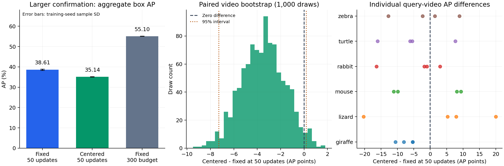

# Larger confirmation of frozen feature centering

The primary paired effect is **-3.469 AP points** at equal 50-update budgets.
The paired, class-stratified query-video bootstrap 95% interval is **[-7.286, +0.196]**.
The interval includes zero. This larger check does not establish an improvement at the matched budget.

## Aggregate results

| Method | Training budget | AP mean ± seed SD | AP50 mean | AP75 mean |
|---|---:|---:|---:|---:|
| Fixed | 50 | 38.605 ± 0.293 | 50.509 | 40.807 |
| Centered | 50 | 35.137 ± 0.130 | 45.438 | 37.023 |
| Fixed reference | 300 | 55.102 ± 0.082 | 72.582 | 57.495 |

Three training seeds: 42, 43, 44. Seed SD is not uncertainty over new data.
The reference has a 300-update training budget and uses validation-selected checkpoints. The primary pair has exactly 50 updates and a shared 300-update learning-rate schedule.

| Seed | Fixed 50 AP | Centered 50 AP | Difference | Fixed 300 reference AP |
|---|---:|---:|---:|---:|
| 42 | 38.276 | 35.140 | -3.136 | 55.192 |
| 43 | 38.705 | 35.265 | -3.440 | 55.034 |
| 44 | 38.836 | 35.005 | -3.831 | 55.080 |

## Class-level AP

| Class | Fixed 50 | Centered 50 | Difference |
|---|---:|---:|---:|
| giraffe | 68.553 | 61.735 | -6.818 |
| lizard | 30.525 | 27.366 | -3.159 |
| mouse | 20.595 | 17.022 | -3.573 |
| rabbit | 56.394 | 52.970 | -3.425 |
| turtle | 12.987 | 8.393 | -4.594 |
| zebra | 42.578 | 43.333 | +0.755 |

## Fixed protocol and limits

Six fresh classes: giraffe, lizard, mouse, rabbit, turtle, zebra. There are 24 distinct videos, 192 distinct frames, 120 balanced two-way one-shot episodes, and 960 episode-frame instances. Repeated frames are not independent samples.

Every class and video is disjoint from the original splits and both earlier fresh confirmations. All nine checkpoints, thresholds, and the training-only feature center were fixed before scoring. Every query video is tested against every other class. Its support crops come from other videos. A video can supply support to another query episode.

The bootstrap uses 1,000 shared draws with seed 20261030. Each draw resamples four query videos within each of the six fixed classes, retaining all related frames and episodes. The interval is conditional on the fixed class identities, support episodes, and trained seed pairs. It excludes uncertainty from new classes, new support examples, and model development. It is not an unconditional significance claim.

All methods use one shared frozen OWLv2 SDPA feature cache. The optional kernel preserves the attention equation and differs slightly in floating-point rounding from native eager attention. The pre-score kernel check and complete cache hashes are in `protocol/`. The historical eager cache and all earlier results remain intact.

## Records and reproduction

- `protocol/`: pre-score selection, manifest, episodes, support pool, model hashes, cache hashes, and extraction checks.
- `evaluations/`: nine metric files with exact predictions and ground truth. All AP/AP50/AP75 values were recomputed from these records.
- `verified_summary.json`, `comparison.csv`, and `paired.csv`: aggregate and paired results.
- `bootstrap_draws.json`: actual query-video multiplicities, per-model AP draws, and paired effects.
- `per_video.csv`: diagnostic single-query-video AP; its average is not aggregate COCO AP.
- `per_class.csv`: native COCO AP by class, averaged across training seeds.
- `evaluation_environment.json`, `cache_metadata/`, and `download_manifest.json`: software, encoder, image CRCs, dimensions, and hashes.
- `source_artifact_sha256.json`: hashes of the copied raw metric and detection records.

See the [pre-score plan](../../docs/LARGER_CONFIRMATION_PLAN.md) and [executable runbook](../../docs/RUNBOOK.md#larger-confirmation-without-further-training). The source head training records are in [revision_v5](../revision_v5/README.md) and [revision_v2](../revision_v2/README.md). Weights are retained locally; a public weight download is still required for final submission. No source RGB images or model tensors are stored in Git.

Keep the earlier +0.612 AP small-set result and the failed full-budget centering and memory-rule experiments. This larger check does not replace those records. No model was changed after reading these scores.
