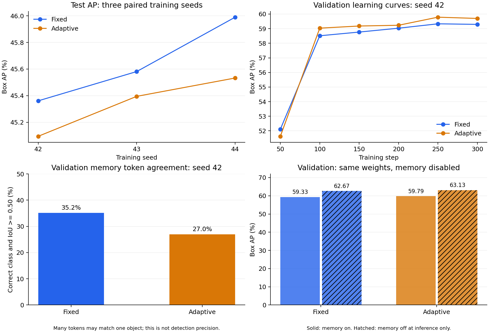

# Verified real-video pilot

Source artifacts from the user's Colab experiment were imported on 24 October 2026. Dataset images and model weights are excluded from Git. The original downloaded experiment, including weights, remains in the adjacent local `adaptive-fsvod-experiment` directory. Public weight links are pending.

## Results

| Method | Test AP, mean ± sample SD | AP50, mean ± sample SD | AP75, mean ± sample SD |
|---|---:|---:|---:|
| Fixed | 45.64 ± 0.32 | 53.27 ± 0.34 | 50.81 ± 0.28 |
| Adaptive | 45.34 ± 0.22 | 53.04 ± 0.23 | 50.39 ± 0.21 |

Training seeds are 42, 43, and 44. The same episode files and configurations were used throughout. Adaptive test AP was lower in all three pairs; the exact mean paired difference is -0.3035 AP points. Sample SD describes training-seed variation on the same small test set.



## Contents and checks

- `source_runs/`: original configurations, complete training logs, final validation metrics, test metrics, and test ground truth and predictions for all six runs.
- `protocol/`: unmodified class/video manifests, episode files, cache signatures, and support pools. Absolute cloud image paths remain in the original manifests to preserve their hashes. Use `VideoManifest(path, images_root=<local images directory>)` for local image inspection.
- `pilot_summary.json`, `pilot_summary.csv`: full precision aggregates and validation diagnostics for the selected checkpoints.
- `local_verification.json`: all six best checkpoint hashes verified against evaluation records; training seed, step, configuration, input hashes, and cache settings checked; final training step 300 verified. All 249 image SHA-256 hashes passed, with class/video separation and episode validation checks.
- `coco_recomputation.json`: all six AP/AP50/AP75 results recomputed from their saved predictions and ground truth, with exact agreement to reported results.
- `validation_memory_diagnostics_seed42.json`: seed-42 validation AP reproduced on CPU from both actual model checkpoints, with exact agreement to the GPU-session values; token agreement and same-checkpoint memory-off ablations.
- `transfer_manifest.json`: downloaded source archive checksum and verification of the older seed-42 archive checksum.
- `artifact_sha256.json`: SHA-256 values for the 56 imported source and derived JSON/CSV/log files. The figure and this README are not part of that imported-file manifest.

Source training revision: `69268ece373f28e468681a4081c9df745d95b33e`, clean working tree. The model, training, data, cache, and evaluation code at that revision is unchanged in the later analysis revision. Original environment: Python 3.13.16, PyTorch 2.11.0+cu130, CUDA 13.0, Transformers 4.46.3, NumPy 2.1.3, SciPy 1.16.3, Pillow 11.3.0, pycocotools 2.0.11, Tesla T4. Recorded training-loop time including validation was 23.38–24.56 seconds per 300-step run; it excludes setup and encoder feature extraction. Peak GPU memory was not recorded.

## Validation diagnosis

Memory tokens were checked only for frames whose memory is consumed by a subsequent frame in the episode. A token agrees with the annotation if its predicted class is correct and its predicted box has IoU >= 0.50 with at least one annotated object of that class. Multiple tokens can match the same object; this is not standard detection precision.

| Seed-42 validation diagnostic | Fixed | Adaptive |
|---|---:|---:|
| Selected tokens in consumed frames | 293 | 456 |
| Tokens with correct class and IoU >= 0.50 | 103 (35.15%) | 123 (26.97%) |
| Ground-truth objects covered by at least one selected token | 80/101 | 85/101 |
| Thresholds at the adaptive lower bound | 0/188 | 176/188 |
| Validation AP with memory | 59.33 | 59.79 |
| Validation AP, same weights with memory disabled | 62.67 | 63.13 |

Of 192 adaptive selections below confidence 0.7, only 19 (9.90%) agreed with the ground truth under this criterion. The adaptive rule increases object coverage slightly while accepting many weak or poorly localized tokens. Disabling temporal memory at inference improves validation AP for both checkpoints. This supports investigating reliability controls on temporal fusion. It does not prove which token causes each error, and a memory-off checkpoint is not a separately trained no-memory baseline.

These are validation diagnostics. No new test result has been generated for a revised method. Future revisions must use validation data for selection and disclose that the original test set was already inspected. Prefer a fresh held-out confirmation set.

## Reproduce the local analysis

With the original experiment directory and dependencies installed, run from the repository root:

```bash
python -u -m adaptive_fsvod.pilot --experiment-dir ../adaptive-fsvod-experiment --action collect --seeds 42 43 44
python scripts/diagnose_memory.py --experiment-dir ../adaptive-fsvod-experiment --seed 42 --device cpu --threads 4
python scripts/plot_pilot.py --experiment-dir ../adaptive-fsvod-experiment --output results/pilot_20261024/pilot_diagnostics.png
```

The full three-seed archive created locally is `exports/pilot_seeds_42_43_44.zip`, 327,786,402 bytes, SHA-256 `3bf468dc5b1ec5a2f9a0b62165e40703638ee410ae102897d86951e7681d2b75`. It contains all six trained runs and the initial aggregate results. The later CPU diagnostics are stored separately beside it and in this directory.
