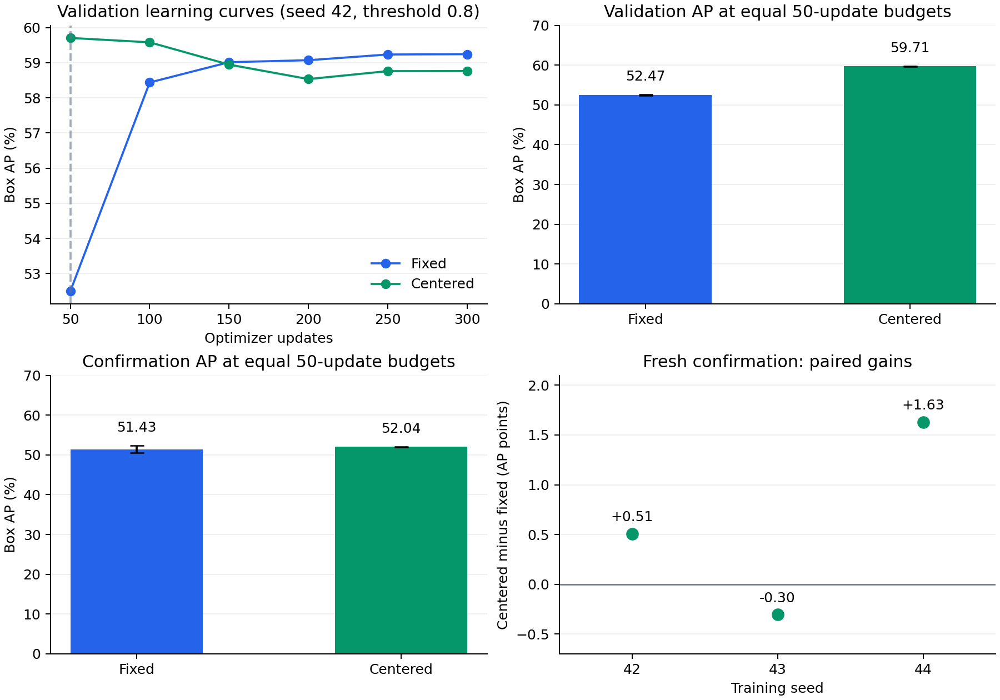

# Limited-budget feature-centering result

**Follow-up:** the larger, frozen-model confirmation did not reproduce this small-set gain. Across six further unseen classes, 24 videos, and 192 frames, fixed/centered 50-update AP was **38.61/35.14**. Centering was lower for all three seeds. Read the [larger confirmation and uncertainty analysis](../larger_confirmation/README.md) with this historical result. Do not claim a general faster-adaptation benefit.

This reduced adaptation was evaluated after **50 actual optimizer updates per method**, with a shared 300-update learning-rate schedule. It does not claim higher fully converged accuracy or reproduction of the paper's full benchmark.

## Results

Three paired training seeds (42, 43, 44), fixed two-way one-shot support/query episodes:

| Method | Validation AP, mean ± sample SD | Fresh AP, mean ± sample SD | Fresh AP50 | Fresh AP75 |
|---|---:|---:|---:|---:|
| Fixed, 50 updates | 52.47 ± 0.13 | 51.43 ± 0.93 | 58.32 | 54.51 |
| Centered, 50 updates | 59.71 ± 0.07 | 52.04 ± 0.08 | 59.08 | 57.05 |

Fresh AP gain: **+0.6116 points on average**, two positive pairs and one negative pair:

| Seed | Fixed AP | Centered AP | Difference |
|---|---:|---:|---:|
| 42 | 51.6087 | 52.1168 | +0.5082 |
| 43 | 52.2621 | 51.9583 | -0.3039 |
| 44 | 50.4191 | 52.0496 | +1.6304 |



## Method and controls

Subtract a class-balanced mean of normalized **training support-crop features**, then normalize again before support prototype construction and current-frame temporal processing. Store the mean as a frozen 512-value checkpoint buffer. Fit it without validation or confirmation data. Both methods have 2,103,815 trainable parameters. This adapts the centering idea from [SimpleShot](https://arxiv.org/abs/1911.04623); centering itself is not claimed as globally new.

Both families received three memory-threshold trials (0.6, 0.7, 0.8) at seed 42 using validation AP; both selected 0.8. Both then used four CPU threads, 50 actual updates, schedule horizon 300, warmup 15, AdamW lr 1e-4, weight decay .01, and the same losses, data, and episode order. The update-cap test proves that stopping at 50 preserves the schedule prefix. Every centered seed-42 model tensor exactly matches its update-50 checkpoint from the earlier 300-update run.

Training uses six classes, 18 videos, and 131 frames; validation uses three classes, nine videos, and 50 frames. Confirmation uses **three further classes (ape, shark, dog), six distinct videos, and 18 distinct frames**. All classes and videos are disjoint from the original three splits and the first confirmation subset. Pool seed 42 provides two candidate support crops per class, one per video; each query uses support from another video. Selection seed 20261026 and episode seed 20261027 produce 30 fixed episodes and 90 episode-frame instances. Repeated episodes do not create independent new videos.

All six selected checkpoint hashes and configurations were committed before confirmation scoring in `9752fc4`; see `pre_confirmation_manifest.json`. No method setting or seed was chosen from these confirmation scores.

## Evidence and checkpoints

- `selection.json`, `replications.json`, `configs/`, `source_runs/`: full validation search, selected settings, environments, and logs, including unsuccessful thresholds.
- `confirmation_protocol/`: unmodified data and episode manifests, image hashes, cache metadata, and support pool. Source images and cached feature tensors are excluded from Git.
- `confirmation/`: original metrics, ground truth, and predictions for all six runs. All AP/AP50/AP75 scores were independently recomputed with exact agreement.
- `verified_summary.json`, `comparison.csv`: full precision results, all paired differences, source checkpoint hashes, and inference file hashes.
- `confirmation_artifact_sha256.json` and `pre_confirmation_manifest.json`: byte-level source verification. Git preserves result bytes across checkouts.

Six full trained checkpoints remain in the experiment directory. Local inference bundle: `exports/fast_adaptation_inference.zip`, **46,857,902 bytes**, SHA-256 `bd2ff53435f8a79590cf3613e8f031ec9e25a77d785ee9139597a0b3b4fc4262`. All exported files were reloaded; every model-state tensor, including the feature center, matched the full checkpoint exactly. Inference files omit optimizer/scheduler/RNG state and cannot resume optimization. Public weight links are pending.

Training environment: Windows 11, Python 3.12.3, PyTorch 2.9.1 CPU, Transformers 4.46.3, NumPy 1.26.4, SciPy 1.13.0, Pillow 10.3.0, pycocotools 2.0.11. Training revision `e5865661abb5c40e477ebdc022d22dbcccca97ec`, clean tree. Shared original caches were extracted on T4; confirmation features were extracted on CPU with the same pinned encoder. Complete per-run provenance is included.

## Limits and previous attempts

The result is preliminary evidence for **limited-update adaptation** on a very small independent set. One of three pairs declined. No statistical significance, universal improvement, encoder speed, or stronger fully trained model claim is made. Best 300-update centered validation AP (59.704) did not beat the tuned baseline (59.776).

Previous failures are preserved: adaptive thresholds reduced the original test mean from 45.64 to 45.34 AP; confidence gating scored 22.54 versus 22.94 on the first fresh set despite a validation gain; objectness weighting failed validation; full-budget centering also failed its criterion. The limited-update hypothesis was selected after inspecting validation curves, as disclosed in [the amendment](../../docs/FAST_ADAPTATION_PLAN.md). The second fresh subset stayed unscored until the final freeze. Earlier scores use different subsets and must not be directly compared with these values.

## Reproduce

After original data preparation, caching, and episode generation:

```bash
python -u scripts/run_fast_study.py --experiment-dir /path/to/adaptive-fsvod-experiment --stage all --threads 4
python scripts/export_fast_results.py --experiment-dir /path/to/adaptive-fsvod-experiment --output results/revision_v5
```

The first command resumes runs, searches and replicates both methods, prepares and caches the deterministic fresh subset, freezes input hashes, and evaluates. CPU is default; `--cache-device cuda` changes only confirmation encoder extraction. Reported confirmation caches used CPU. The second command verifies metrics and exported weights, then creates the CSV and figure. See the runbook for individual training commands.
