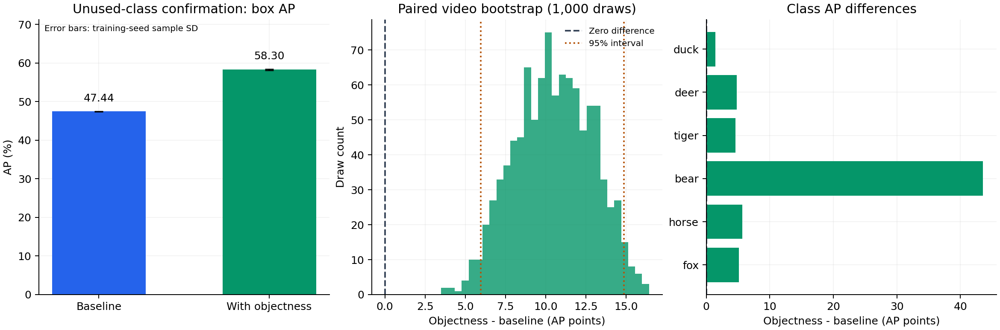

# Objectness in the final detection score

The fresh-set paired change is **+10.858 AP points**.
The paired, class-stratified query-video bootstrap 95% interval is **[+5.960, +14.850]**.
The conditional interval is positive on this protocol.

## Method

Use `score = class_score * objectness ** beta` before the existing class-wise NMS. Validation selected beta=1 from {0, 0.5, 1}. Keep the original foreground/background decision, boxes, model weights, and temporal memory computation. beta=0 is the baseline.

This is a ranking heuristic that adds beta*log(objectness) to log(class_score). The scores are correlated and need not be calibrated probabilities. The product is not claimed as an exact probability. This applies known objectness information to this reduced few-shot video decoder; no globally new detection principle is claimed.

## Fresh results

| Method | AP mean ± seed SD | AP50 | AP75 |
|---|---:|---:|---:|
| baseline | 47.440 ± 0.091 | 62.435 | 50.852 |
| objectness | 58.298 ± 0.182 | 75.044 | 62.798 |

| Seed | Baseline AP | Objectness AP | Difference |
|---|---:|---:|---:|
| 42 | 47.395 | 58.131 | +10.736 |
| 43 | 47.380 | 58.271 | +10.891 |
| 44 | 47.544 | 58.491 | +10.947 |

## Class AP

| Class | Baseline | Objectness | Difference |
|---|---:|---:|---:|
| fox | 60.703 | 65.819 | +5.116 |
| horse | 49.034 | 54.683 | +5.649 |
| bear | 15.104 | 58.657 | +43.554 |
| tiger | 63.606 | 68.223 | +4.617 |
| deer | 46.051 | 50.841 | +4.790 |
| duck | 50.140 | 51.563 | +1.422 |

6 of 6 class means improved. The largest gain was bear (+43.554 points). Interpret the aggregate mean together with the class table.

## Protocol and limits

Six unused classes: fox, horse, bear, tiger, deer, duck; 24 videos; 192 distinct frames; 120 balanced two-way one-shot episodes. All prior classes and videos were excluded. Model hashes, selected beta, data, episodes, and the complete shared feature cache were frozen in Git before scoring.

Both methods use the SAME three 300-update-budget baseline heads, with original validation-selected checkpoints (steps 250, 250, 300). No additional head training, encoder pass, trainable parameter, or label is introduced by score calibration. The score uses each proposal's frozen encoder objectness before learned box refinement.

Validation AP averaged 59.871 without calibration and 75.138 with beta=1. All three validation pairs improved. These validation scores selected the method; only the separate unused-class set supplies confirmation evidence. beta=0 exactly reproduced all three archived baseline validation AP values.

The 1,000 paired bootstrap draws resample query videos within each fixed class and retain all related frames and episodes. The interval is conditional on those classes, fixed support examples, and trained seed pairs. Training-seed SD is not data uncertainty. A video can supply support to another query episode; support sampling uncertainty and new-class uncertainty are not covered. Do not claim a gain on the original paper's full benchmark or every new dataset.

## Records and reproduction

`protocol.json` and `validation/` preserve the pre-score plan and all seven validation evaluations. `confirmation_protocol/` contains the unused-class selection, episodes, support pool, verified image records, and complete feature hashes. `evaluations/` contains all six raw metric/prediction/ground-truth sets. Every AP/AP50/AP75 value was recomputed exactly. `bootstrap_draws.json` stores all multiplicities and per-model AP draws. `confirmation_artifact_sha256.json` verifies raw source bytes. `per_video.csv` is a diagnostic; its mean is not aggregate COCO AP.

See [the pre-score plan](../../docs/SCORE_CALIBRATION_PLAN.md) and [the runbook](../../docs/RUNBOOK.md). The same trained heads support both methods; evaluation must set `--objectness-beta 0` for baseline or `--objectness-beta 1` for the proposed score. Encoder weights are public and pinned. Head weights are verified locally; public download links remain required before final submission.

The shared head training configurations and complete logs are in [fixed seed 42](../revision_v2/source_runs/fixed_tau060_seed42/), [seed 43](../revision_v2/source_runs/fixed_tau060_seed43/), and [seed 44](../revision_v2/source_runs/fixed_tau060_seed44/). They record the original CPU environment, hyperparameters, and validation checkpoint selection. No separate proposed-head training log exists because the proposed method performs no additional training.

All earlier unsuccessful memory and centering studies remain in the repository. They are not replaced by this result.
